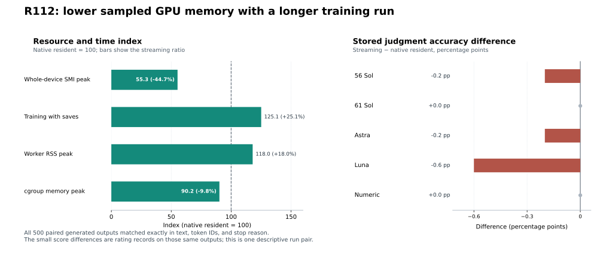

# Streaming lowered sampled GPU memory while adding 25% to training time

## Executive summary

In this single R112 run pair, SpillTune streaming reduced the sampled whole-device SMI memory peak by **44.7%** (2.03 GiB vs. 3.67 GiB) while increasing training-with-saves time by **25.1%** (76.27 vs. 60.98 minutes). All 500 paired generated answers matched exactly in text, token IDs, and stop reason. The 500-step loss traces matched. The original local audit reports equal `state.safetensors` bytes at all six checkpoint boundaries; this public package contains equal SHA-256 and length fingerprints but omits the tensor files, so the binary equality cannot be independently re-hashed from the release.

The five stored judgment channels differed by 0.0 to −0.6 percentage points between arms. Because the generated outputs were identical, these differences occur in ratings of the same answers; they do not indicate a change in model output. This descriptive one-run comparison is not a statistical equivalence test or a claim of universal quality preservation.

## Measured comparison

| Measure | Native resident | SpillTune streaming | Streaming vs. resident |
|---|---:|---:|---:|
| Training with checkpoint saves | 3,658.70 s (60.98 min) | 4,576.40 s (76.27 min) | +25.1% |
| Whole-device SMI sampled memory peak | 3,938,451,456 B (3.67 GiB) | 2,176,843,776 B (2.03 GiB) | −44.7% |
| Worker RSS sampled peak | 7.32 GiB | 8.63 GiB | +18.0% |
| cgroup memory sampled peak | 9.98 GiB | 9.00 GiB | −9.8% |
| cgroup swap sampled peak | 0 B | 0 B | 0 B |

The SMI value is a whole-device sample and is not process-exclusive allocated memory or a guaranteed instantaneous maximum. RSS, cgroup memory, and device memory describe different scopes. The sampler reported unavailable cgroup I/O deltas, so this report does not estimate I/O throughput. The training-time ratio is 1.2508× in this pair; no CPU or GPU-offload baseline was run.

## Quality and output evidence

| Judgment channel label | Native resident | Streaming | Difference (percentage points) | Paired lower / equal / higher |
|---|---:|---:|---:|---:|
| `codex_56_sol_max` | 404/500 (80.8%) | 403/500 (80.6%) | −0.2 | 1 / 499 / 0 |
| `codex_61_sol_max` | 404/500 (80.8%) | 404/500 (80.8%) | 0.0 | 0 / 500 / 0 |
| `codex_6_astra_max` | 404/500 (80.8%) | 403/500 (80.6%) | −0.2 | 1 / 499 / 0 |
| `codex_6_luna_max` | 406/500 (81.2%) | 403/500 (80.6%) | −0.6 | 3 / 497 / 0 |
| `numeric` | 402/500 (80.4%) | 402/500 (80.4%) | 0.0 | 0 / 500 / 0 |

The score grain is one item per channel and arm. Each arm had 500 items per channel, with 499 EOS stops and one `max_new_tokens` stop; the non-EOS item was incorrect in each channel. `effective_correct` is `raw_correct AND stop_reason == 'eos'`, and it equals `raw_correct` for this run. Scores are retained by channel; there is no majority-vote aggregate.

The R112 POST_TRAIN source contains 1,000 generated output records. For every item, the native-resident and streaming records have identical raw UTF-8 text, ordered generated token IDs, and stop reason. No normalization was applied before comparing them. The score totals therefore show small differences in recorded judgments of the same generated text. Channel labels and TUI receipts do not independently authenticate backend model identity; results are reported using the stored channel labels only.

Both arms ran 500 updates and 3,000 microbatch presentations with gradient accumulation 6. Their 500 loss values match exactly in the packaged records (first 0.7787922025; last 0.5598102212; mean 0.4936317078; median 0.4903827757). The published checkpoint fingerprint table records equal SHA-256 digests and lengths at updates 0, 100, 200, 300, 400, and 500. The original local audit reports that it compared the checkpoint files themselves and found equal bytes. Checkpoint tensors are omitted here, so the public verifier checks fingerprint equality only and cannot re-hash the original binary files.

The experiment used `repeat_count=1` and `repeat_index=0`; these fields are not interchangeable. The original local audit records separate worker processes, plan bindings, work directories, and checkpoint directories. It also reports distinct checkpoint inodes with link count one. This sanitized package does not expose those original paths or inode records, so readers cannot independently recheck the filesystem-level evidence. The public package does show the two arm labels, source snapshot binding, and matching published checkpoint fingerprints; it does not prove that bitwise equality is inevitable on every device or software stack.

## What was compared

The Q4 recipe is `qwen35_nf4_dq_bf16c`: NF4 quantization with double quantization, BF16 compute, and FP32 adapter parameters. Both arms used the same seed (20261019), LoRA rank 8 / alpha 16, data order, optimizer settings, and frozen code snapshot. The optimizer was AdamW with learning rate 2e-4, betas (0.9, 0.999), epsilon 1e-8, and zero weight decay.

The comparator is `independent_native_resident`, not GPU native offload. It uses the official bitsandbytes 4-bit matmul and keeps packed NF4 records and their `QuantState` on CUDA; its decoder layers use native non-reentrant activation checkpointing. The streaming arm stages each layer's packed records from pinned CPU memory to CUDA for forward and backward, then recomputes the original decoder layer during the custom backward pass and returns gradients. Both arms use the same NF4 artifact and initialization.

The frozen code snapshot SHA-256 is `5c64acd760d4c2f990f3bb403a75b1f7e05dcfe5182fa54df491cf97a6ed1f9f`. Nineteen source files on the execution, inference, scoring, adapter, recomputation, pool, backend, and checkpoint paths are included byte-for-byte under `source/frozen/`; `source/snapshot_file_index.json` records relative paths and hashes for all 559 snapshot files, without the private worktree path. The other 540 file contents are not included.

The later public SpillTune Q4 library commit is `d8764fbed6004897c74afd14ba5e34875dc3d6a2`. A local path-and-byte comparison found six of the 19 included files byte-identical to that commit. `src/ram_vram_finetune/adapters/qwen35/nf4_cuda.py` is present but differs from its frozen R112 bytes; the other 12 included paths are absent. The commit publishes the maintained Q4 library API, not the full R112 experiment harness. The included 19 files are source evidence, but neither they nor the hash-only index make the original run independently replayable. The package verifier recomputes public aggregates from sanitized exports; full training/inference replay would require additional source bodies, the exact runtime environment and model revision, and model weights, which are not provided.

## Hardware and software environment recorded for R112

These values come from the historical per-arm preflight, runtime-binding, and hardware-command records. Their original file sizes and SHA-256 digests are listed in [`data/source_provenance.json`](../data/source_provenance.json). The release retains the public-safe values only; it strips hostnames, PIDs, device UUIDs, cgroup paths, and absolute paths. They describe the R112 records, not the current machine.

| Component | Recorded R112 value | Scope and source notes |
|---|---|---|
| GPU | NVIDIA GeForce RTX 4060 Laptop GPU; compute capability 8.9 | Same model and capability in both arms' runtime bindings. |
| CUDA device memory | 8,184,725,504 bytes (about 7.62 GiB) | `cuda_total_bytes` from each arm's preflight record; this is the recorded CUDA device total, not the sampled usage peak. |
| CPU model | Not recorded in the retained R112 environment evidence | Not inferred from the current host. |
| Host RAM | Physical total not recorded. Preflight `MemAvailable`: native resident 31,410,716,672 B; streaming 30,622,216,192 B. | These are separate startup-available-memory snapshots, not total RAM or training-time peaks. |
| OS and kernel | Kernel release `7.0.0-38-generic`; distribution release not recorded | The published evidence does not identify a Linux distribution. |
| NVIDIA driver | `580.178.04` | Recorded by each arm's hardware command result. |
| CUDA runtime/build | PyTorch CUDA build/runtime `13.0`; runtime binding `cuda`; `libbitsandbytes_cuda130.so` | The system CUDA toolkit version was not separately recorded. |
| PyTorch | `2.13.0+cu130` | Same in both arms' preflight and runtime bindings. |
| Transformers | `5.13.0` | Same in both arm bindings. |
| bitsandbytes | `0.50.2` | Same in both arm bindings. |
| Python | Version not recorded in the retained environment records | Not inferred from the current host. |

The execution-domain label is `LOCAL_OS_STARTUP_NOT_GPU_QUALIFICATION`; these records do not represent independent GPU qualification. `data/source_provenance.json` lists hashes for the safe source records used in this table so the public summary can be traced to the captured run files without publishing their private metadata.

## Data and reproduction

The training and evaluation data were prepared from `openai/grade-school-math` at revision `3101c7d5072418e28b9008a6636bde82a006892c` (MIT). The release exports the 1,500 training rows as the token arrays used in training, the 500 evaluation questions and reference answers, 1,000 generated answers, 5,000 judgment rows, 1,000 update/loss records, and 7,925 normalized hardware samples. See [`DATA_LICENSES.md`](../DATA_LICENSES.md) and [`data/source_provenance.json`](../data/source_provenance.json) for license and source hashes.

Run `python scripts/verify_release.py` to recompute the published counts, exact output equality, score table, loss equality, resource peaks, and checkpoint fingerprint equality using only the sanitized release data. The verifier does not run a model, re-hash omitted checkpoint tensors, or contact a scoring provider. The original SQLite databases and private manifests are not included; their SHA-256 hashes and extraction rules are recorded in the provenance file. `python scripts/render_tradeoffs.py --preview /tmp/r112-tradeoffs.png` regenerates the SVG from `reports/summary.json` and writes an optional PNG preview (Matplotlib required).

## Limits

- This is one local run pair, with one repeat. It supplies descriptive evidence only; no confidence interval, p-value, preregistered equivalence margin, or scientific acceptance decision is claimed.
- The run metadata labels the execution domain `LOCAL_OS_STARTUP_NOT_GPU_QUALIFICATION`. The local records indicate the training path used `cuda:0` (`CPU_contract_only=false`), but there was no independent GPU qualification.
- SMI samples measure the whole device. The reported memory reduction must not be described as allocator-only or per-process-exclusive memory.
- The model path was not pinned to a repository revision. We do not redistribute model weights, adapter weights, or checkpoints; exact model rerun is not guaranteed from this repository alone.
- CPU model, physical host RAM total, Python version, OS distribution release, and system CUDA toolkit version were not captured in the retained environment records. Available-memory preflight snapshots must not be described as total RAM.
- The checkpoint file identity/inode comparison comes from the original local audit. This release publishes matching hashes and lengths but contains neither state tensors nor inode/path evidence for an independent filesystem-level check.
- Only 19 source bodies are distributed from the 559-file frozen snapshot. The linked SpillTune commit contains six byte-identical files from this slice, one present-but-different adapter file, and not the other 12; it is not the complete R112 experiment source.
- No CPU comparison and no native-offload comparison were run. These results do not support a CPU-vs-GPU time claim.
- The scoring lane labels are not independent authentication of the scorer's backend identity. Numeric scoring used a frozen decimal parser. cgroup I/O samples were unavailable.
- The report does not claim a fine-tuning gain over the base model or production readiness.
